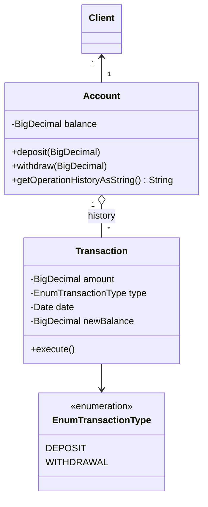

# Kata – Bank Account

[](https://github.com/ayouamani/bankAccount/actions/workflows/ci.yml)


The **Bank Account kata** (a classic technical exercise in banking interviews), implemented test-first in plain Java.

> Think of your personal bank account experience. When in doubt, go for the simplest solution.
>
> - **US 1** – As a bank client, I want to make a deposit in my account to save money.
> - **US 2** – As a bank client, I want to make a withdrawal from my account to retrieve some or all of my savings.
> - **US 3** – As a bank client, I want to see the history (operation, date, amount, balance) of my operations.

## What this kata shows

- **TDD, test names as specifications** – 21 tests written before the code, named after the business rule they protect:
  `shouldFailWhenTryingToDepositNegativeAmount`, `ShouldFailToWithdrawWhenInsufficientFunds`, `shouldPrintHistoryWhenDepositAndWithdraw`…
- **Money done right** – amounts are `BigDecimal`, never `double`.
- **Rich domain model** – the `Transaction` validates itself (no null account, null type, null or negative amount) and applies itself to the `Account`; the account keeps its history.
- **Explicit business errors** – `InvalidTransactionException` (invalid operation) and `InvalidAmountException` (insufficient funds, with a readable message such as `withdraw 1200 but balance is 500`).
- **Isolation with mocks** – `TransactionTest` mocks the `Account` with Mockito to verify the interaction (`increaseBalance` / `decreaseBalance`) independently of the real implementation.
- **Fluent assertions** – AssertJ `assertThatThrownBy(...).isInstanceOf(...).hasMessage(...)`.

## Example

```java
Account account = new Account(new Client());
account.deposit(new BigDecimal(7500));
account.withdraw(new BigDecimal(2000));
account.printHistory();
```

```text
Sun Nov 15 10:42:03 CET 2026 | DEPOSIT | 7500 | 7500
Sun Nov 15 10:42:03 CET 2026 | WITHDRAWAL | 2000 | 5500
```

```java
account.withdraw(new BigDecimal(9000)); // throws InvalidAmountException: withdraw 9000 but balance is 5500
```

## Domain model



## Tech stack

| | |
|---|---|
| Language | Java 8 (no framework) |
| Build | Maven |
| Tests | JUnit 4, AssertJ, Mockito |
| CI | GitHub Actions |

## Run it

Requirements: JDK 8 and Maven 3.6+.

```bash
git clone https://github.com/ayouamani/bankAccount.git
cd bankAccount/societe-generale
mvn test
```

## Project structure

```text
societe-generale/
├── src/main/java/model/      # Account, Transaction, Client, exceptions, transaction types
└── src/test/java/.../model/  # AccountTest, TransactionTest, ClientTest
```

## Possible next steps

- Inject a `Clock` instead of `new Date()` so the history test is fully deterministic.
- Move to `java.time` and JUnit 5.
- Add a statement printer abstraction to decouple formatting from the domain.
